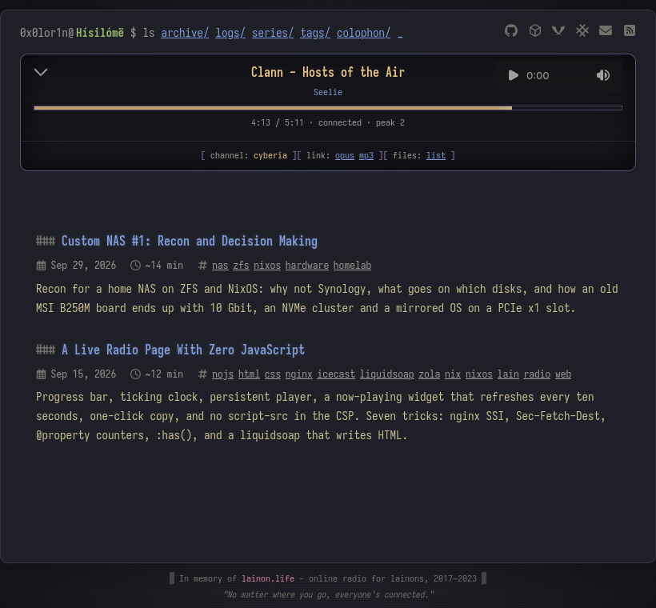

# Hísilómë

The Zola site and the radio station behind [hisilo.me](https://hisilo.me):
a static site with zero JavaScript, and a liquidsoap → icecast stream whose
"now playing" UI is nginx SSI over fragments the encoder rewrites.



Everything here is relative to the repo root (`radio/state/`, `music/`,
`public/`), so run commands from here.

## Build and preview

```sh
nix build            # ./result = the rendered site (packages.default = site)
nix develop          # zola, d2, ffmpeg, flac, icecast, liquidsoap, process-compose + the scripts
build-site           # d2 → svg, then zola build into public/ (SITE_DRAFTS=0 hides drafts)
process-compose up -f process-compose.yaml   # site on :8099 through the prod nginx config + icecast + liquidsoap
process-compose up -f process-compose.yaml -f process-compose.dev.yaml   # same, plus rebuild on change
```

`direnv allow` loads the shell automatically (`.envrc` = `use flake`).

Use `process-compose`, not `zola serve`: the pages carry SSI includes that only
nginx resolves.

## URLs

Every document URL (`/`, `/logs/`, `/<post>/`) serves the shell with that page
in the middle frame; a plain fetch (feed reader, `curl`, an iframe) gets the
page itself. Routing after that is `#/path/` on the shell, so the entry URL is
sticky: open `https://hisilo.me/<post>/` and every later click becomes
`/<post>/#/logs/`. That is by design (the stream never restarts), not a bug;
the shell's `<link rel="canonical">` always names the wrapped page without the
query, so search engines and copy-paste land on `/<post>/`, never on `/listen/`.
The one clean URL on a post is the permalink icon in its meta line (next to
the tags): it opens the post outside the console and follows the door you came
in from (clearnet, ygg, onion).

Hooks: `lefthook.yml` runs gitleaks and the formatters/linters for every file
type in the repo on commit, `nix flake check` (build + vnu over the HTML) on
push. The tools are in the dev shell; `LEFTHOOK=0 git commit` skips them.

## Browser tests

```sh
nix run .#e2e            # Chromium + Firefox against the stack on :8099 (E2E_BASE, loopback only)
nix run .#e2e -- --engine chromium -k router   # pytest args pass through
nix develop .#e2e        # the same + ruff, for writing tests
```

The full run is ~2.5 min (104 tests, both engines), so it is not in the
hooks: `nix flake check` stays browser-free; run it by hand before pushing
shell changes.

`tests/e2e/` pins what the shell's design relies on: the CSS router, the
frames, the one `<audio>` that survives routing and the fold, the SSI
fragments and the online/offline switch. Tests that touch
`radio/state/` go through the `radio_state` fixture, which pauses liquidsoap
and `listener-count` over the process-compose API (`E2E_PC`, default
`:8081`, set in `process-compose.yaml`) and puts the real files back.
Playback tests answer `/stream.opus` from a generated tone (`E2E_TONE`), so
icecast is not involved; `listener-count` is run `--once` against a fake
`admin/stats` into a temp dir (`E2E_LISTENER_COUNT`). Firefox runs through
the `pw-firefox` wrapper, which fixes the launch handshake and gives it a
`libpulse` (see `nix/packages.nix`). `test_http.py` needs no browser: fragment
and asset headers, SSI kept off on fragments, the feed's origin, the stream
proxy with `Icy-MetaData` stripped, and the `429` burst limit; the security
headers only exist in the NixOS module, so their runtime test skips on the dev
conf and the `add_header` inheritance rule is pinned against the nix source.
Not a flake check and not a hook: it needs the running stack, run it by hand.
Browsers are ~1 GB, hence the separate shell.

## Consuming the module

```nix
# flake.nix
inputs.hisilome = {
  url = "github:0x0lor1n/hisilome";
  inputs.nixpkgs.follows = "nixpkgs";
};

# a host
{
  imports = [inputs.hisilome.nixosModules.default];
  services.hisilome = {
    enable = true;
    domain = "hisilo.me";
    stateDir = "/persist/radio";                        # library, queue, state
    sourcePasswordFile = "/run/keys/icecast-source-password";
    adminPasswordFile = "/run/keys/icecast-admin-password";
  };
}
```

The module builds the site with the *host's* `pkgs`, not this flake's
`nixpkgs` input, so a consumer never carries two nixpkgs. This flake's own
pin only serves standalone `nix build` / `nix develop` - keep it on the same
rev as the consumer if you want the two `site` outputs byte-identical.

Options: `enable`, `domain`, `enableACME` (default `true`), `stateDir`
(default `/var/lib/hisilome`), `site` (default the package), `user`/`group`,
`sourcePasswordFile`/`adminPasswordFile` (read at unit start, never in the
store; `null` keeps the loopback-only dev password), `queueRounds`,
`overlayListen` (plain-HTTP `{addr, port}` listeners for a Yggdrasil address
or an onion's local port: no TLS, no HSTS, firewall is yours),
`onionLocation` (an `.onion` to advertise from the clearnet vhost via the
`Onion-Location` header; serving it is `overlayListen` + `services.tor`),
`accessLog` (`enable`, `path`: one JSON file for every door, raw addresses,
`entry` names the door - rotation and shipping are yours), `metrics`
(`enable`, `listenAddress`, `nodePort` 9100, `nginxlogPort` 4040, `pages`:
node_exporter with a textfile the listener poller writes - listeners per
mount, peak, queue length, station up - and prometheus-nginxlog-exporter
folding the log to status × method × page × entry; nothing path-shaped
beyond `pages`, no address, leaves through metrics; the firewall is yours).

The host side - certificate e-mail, firewall, persistence of the ACME state,
`www.` alias - is the consumer's.

## License

Code - [AGPL-3.0-or-later](LICENSE). Texts under `content/` -
[CC BY-SA 4.0](content/LICENSE). Music is not in the repository.
